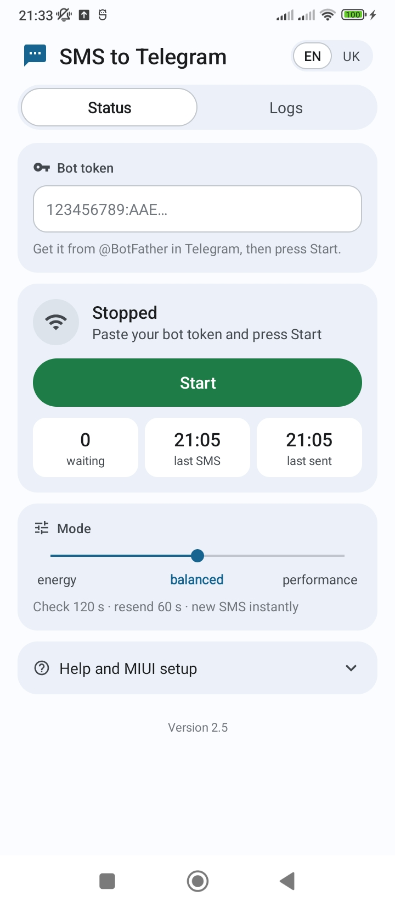
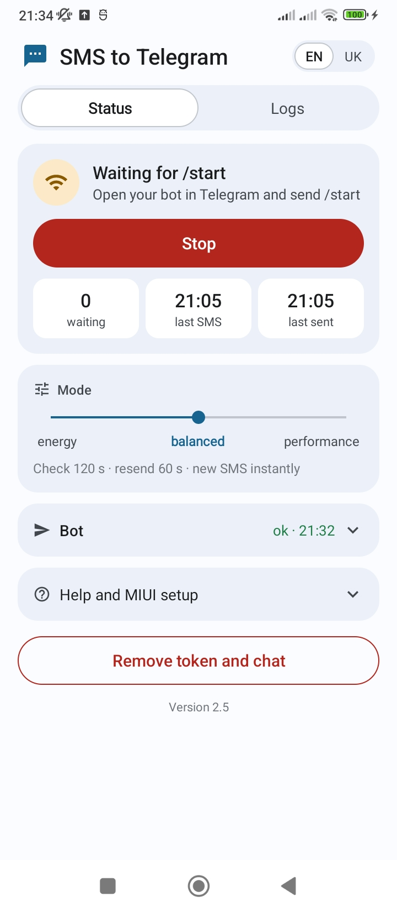
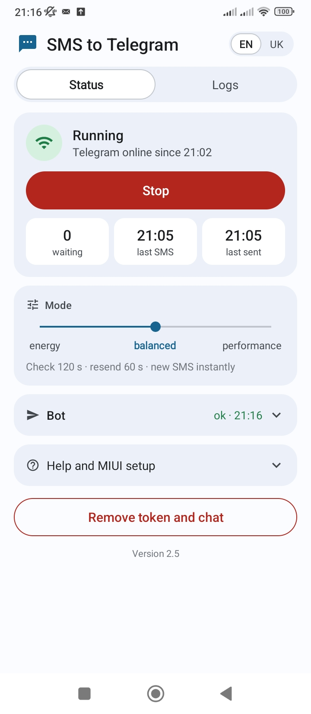
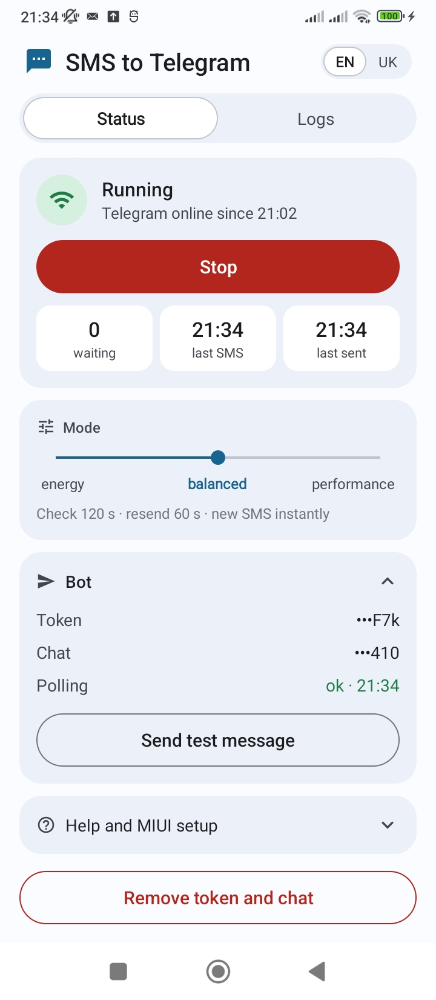
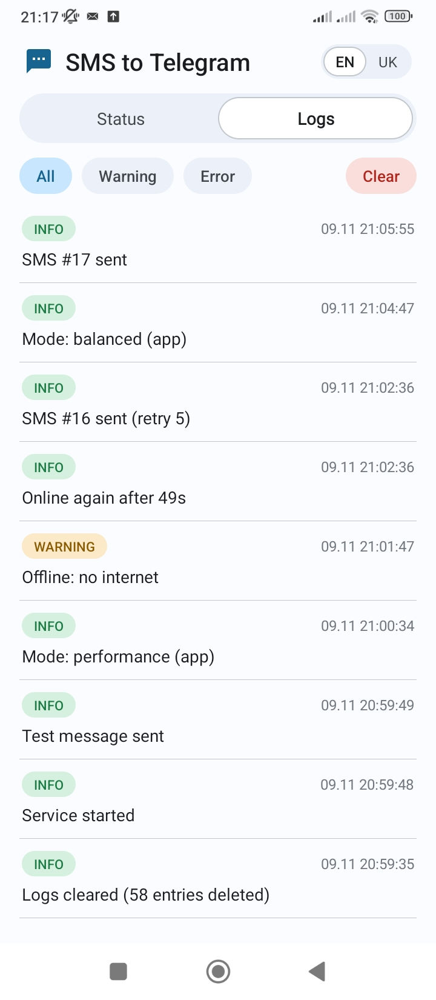
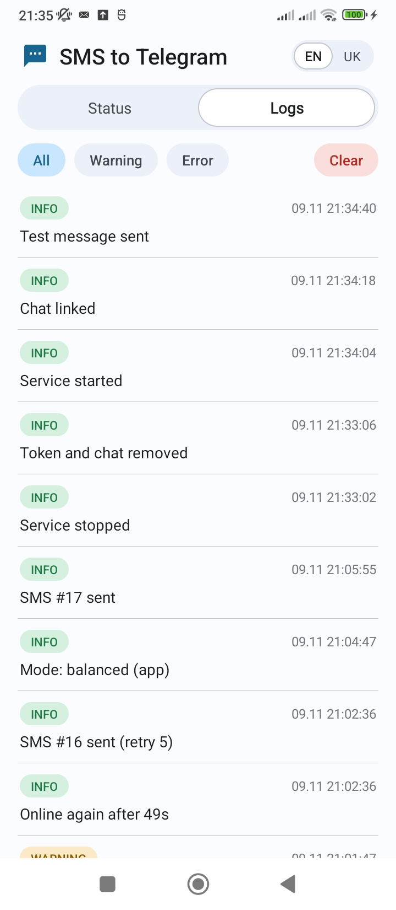
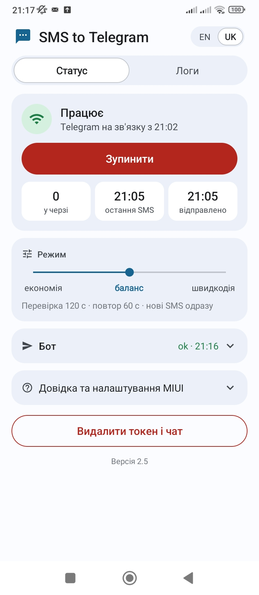

# SMS to Telegram

Forwards every incoming SMS from an old Android phone to your own Telegram bot.
Main goal: deliver every SMS as fast as possible (normally within a minute even if the
first attempt fails) and never lose one because of network problems.

Made for a spare phone that stays at home on Wi-Fi and a charger (tested on Xiaomi, MIUI 13, Android 12,
dual SIM), for example to receive bonus card and bank codes in Telegram.

## Features

- **Every SMS goes to your bot**, from both SIM cards, with the sender, the SIM and the time.
- **Nothing is lost.** An SMS is saved to the phone's database before anything else and waits there
  until Telegram confirms it, however long the connection is down.
- **Fast.** New SMS are sent instantly; failed sends are retried after 1, 2, 4, 8, 16 s.
- **Works in the background** with the screen locked and starts by itself after a reboot.
- **Few requests to Telegram**: about 2 per minute while idle, yet bot commands answer instantly.
- **Three modes** (energy / balanced / performance) for how often the background checks run.
- **Logs** of what matters: sends, connection lost and restored, errors.
- **English and Ukrainian** UI, light and dark theme, colors from the system theme (Android 12+).
- **No third-party libraries**, APK under 1 MB.

## Screenshots

### Setup and linking the chat

<table>
  <tr>
    <td width="33%"></td>
    <td width="33%"></td>
    <td width="33%"></td>
  </tr>
  <tr>
    <td valign="top"><b>1. Setup.</b> Paste the token from @BotFather and press the green <b>Start</b>.
      The app asks for the SMS permission and to ignore battery optimization.</td>
    <td valign="top"><b>2. Waiting for /start.</b> Forwarding runs, but no chat is linked yet.
      Send <code>/start</code> to your bot: the first private chat that does it becomes the only
      chat the bot talks to. SMS received meanwhile wait in the queue.</td>
    <td valign="top"><b>3. Running.</b> Green means Telegram is reachable (and since when). The tiles show
      how many SMS are waiting and when the last one was received and sent. The red <b>Stop</b>
      button stops forwarding completely.</td>
  </tr>
</table>

### Bot and modes

<table>
  <tr>
    <td width="33%"></td>
    <td width="67%" valign="top">
      <b>4. Bot card.</b> Collapsed, it shows only the bot polling state (<i>ok · 21:16</i> in green or an
      error in red). Expanded, it shows the token and chat ID (masked, last 3 characters only) and
      <b>Send test message</b>, which goes through the same path as a real SMS.<br><br>
      <b>Mode</b> sets how often the app checks Telegram and resends what is waiting:
      <b>energy</b> (240 s / 240 s), <b>balanced</b> (120 s / 60 s, default) or <b>performance</b>
      (30 s / 15 s). New SMS are always sent instantly. The mode can also be switched from the bot.<br><br>
      <b>Remove token and chat</b> (with confirmation) forgets the bot to link another one.
    </td>
  </tr>
</table>

### Logs

<table>
  <tr>
    <td width="33%"></td>
    <td width="33%"></td>
    <td width="33%" valign="top">
      <b>5. Connection lost and restored.</b> <i>Offline: no internet</i> at 21:01:47, <i>Online again
      after 49s</i>, and SMS #16 delivered in the same second, on its 5th retry. Individual retries are
      not logged, only the result.<br><br>
      <b>6. Relinking the bot:</b> stopped, token and chat removed, started again, chat linked,
      test message sent.<br><br>
      Filters show only warnings or errors. <b>Clear</b> (with confirmation) deletes all entries and
      leaves one "Logs cleared" line. Entries older than 30 days are deleted automatically.
    </td>
  </tr>
</table>

### Ukrainian

<table>
  <tr>
    <td width="33%"></td>
    <td width="67%" valign="top">
      <b>7. EN / UK</b> in the header switches the language at once. Bot replies and the notification
      follow it too. By default the system language is used. Logs stay in English on purpose: they are
      stored as text and are meant for diagnostics.
    </td>
  </tr>
</table>

## In Telegram

Each SMS arrives as a separate message:

> **Bank**
>
> *SIM1 · 08.11 19:04*
>
> Your code: 1234

The time is when the SMS was sent, as reported by the operator. The text is sent as Telegram HTML
with `&`, `<` and `>` escaped; if Telegram still rejects it, the same message is resent as plain text,
so formatting can never block delivery.

Bot commands (the bot answers only the linked chat):
- `/start`: links the chat (only the first private chat that sends it).
- `/ping`: replies `pong` if the phone is online and the app is running.
- `/perf`: shows the current mode; `/energy`, `/balanced`, `/performance` switch it.

## How it works

### Delivery
1. An SMS arrives → it is saved to the `messages` table first, then the sender thread is woken up.
2. The sender takes unsent messages oldest first and sends each one. If a send fails,
   it retries after **1, 2, 4, 8, 16 s** (2^(n-1)). A new SMS or "network is back" cuts a pause short.
3. If all 6 attempts fail:
   - **no connection / Telegram 429 or 5xx** → the message simply waits, with no limit,
     and is sent as soon as the connection is back;
   - **Telegram rejected it (4xx)** → `tries += 1`. After 5 such rounds the message is given up.
4. The message is sent as Telegram HTML; if Telegram rejects the markup (HTTP 400), the same
   text is resent as plain text.

Delivery is **at least once**: if Telegram accepted a message but its answer was lost (timeout),
the message is sent again. A rare duplicate is preferred over a lost SMS. Only one delivery pass
runs at a time, even while the service is being restarted, so a message is never sent twice in parallel.

Sending is triggered immediately by: a new SMS, Android reporting that a network is available,
the chat being linked, a test message, a mode change. Two timers cover everything else.

### Performance modes
| Mode | Telegram reachability check | Resend of unsent messages |
|---|---|---|
| energy | every 240 s | every 240 s |
| **balanced** (default) | every 120 s | every 60 s |
| performance | every 30 s | every 15 s |

The mode only changes these background timers, to save battery and traffic. New SMS are always
sent immediately. The reachability check is a tiny HEAD request to `api.telegram.org`.
While Telegram is known to be unreachable, the resend timer does nothing; the check timer or
Android's "network available" event sends the queue once the connection is back.

### Connection state
Tracked in one place (`ConnectionMonitor`). It is fed by everything that talks to Telegram
(sending, bot polling, the reachability check) and by Android's "network lost" event.
Only changes are logged: `Offline: <reason>` and `Online again after <duration>`.
When Telegram is back, bot polling resumes at once.

### Bot polling
`getUpdates` with long polling (`timeout=30`): about one request per 30 s while idle,
yet commands are answered immediately. After a network error polling pauses for 30 s
or until the connection is back.

### Logs
Newest first, kept for 30 days, also mirrored to logcat (tag `SmsTg`). Short entries, e.g.
`SMS #12 sent (retry 2)`, `Offline: no internet`, `Online again after 3m 5s`.
- **INFO**: message sent, back online (with the outage duration), mode change, service start/stop;
- **WARNING**: offline (with a short reason: no internet, timeout, network lost, ...);
- **ERROR**: all attempts of a round failed. Individual retries are not logged.

### Database (`smstg.db`)
- `settings`: one row with `bot_token`, `chat_id`, `is_enabled`, `update_offset`, `perf_mode`, `language`.
- `messages`: `id`, `sender`, `text`, `target` (SIM1/SIM2/UNKNOWN/TEST), `sms_time`,
  `is_sent`, `tries`, `created_at`, `updated_at`.
- `logs`: `id`, `created_at`, `level`, `text`.

Times are epoch milliseconds. The schema is upgraded in numbered steps (`AppDatabase.onUpgrade`);
settings from versions up to 1.4 are moved into the database on first start.

### Code layout (`app/src/main/java/ua/home/smstg`)
| Package | Responsibility |
|---|---|
| `model/` | Shared types: `IncomingSms` DTO, `StoredMessage`, `LogEntry`, `Settings`, `PerfMode`, `AppLanguage`, `EventLog` |
| `sms/` | Receives SMS and hands them out as `IncomingSms` through `SmsHandler`. Knows nothing else |
| `data/` | SQLite schema and repositories; the only place with SQL |
| `telegram/` | Bot API client and message formatting |
| `network/` | Reachability check and Android network callback |
| `core/` | Delivery with retries, connection state, SMS inbox, bot commands |
| `service/` | Foreground service: threads and timers only; boot receiver |
| `ui/` | Main screen: `StatusTab` and `LogsTab` render `res/layout/*.xml`; `MainActivity` handles actions |
| `App.kt` | Composition root: creates and wires everything |
| `Lang.kt` | App language without AndroidX |

The UI uses only the Android platform: XML layouts and shape drawables, Material You dynamic colors
on Android 12+ (`res/values-v31`), a fallback palette for older versions, and an automatic dark theme
(`res/values-night*`).

**Texts** are in `res/values/strings.xml` (English) and `res/values-uk/strings.xml`; a missing
translation falls back to English. To add a language, add `res/values-xx/strings.xml` and an entry
in `AppLanguage`.

### Other
- Two receivers listen for `SMS_RECEIVED` (manifest + one registered by the service), because some
  firmwares block one of them; duplicates are dropped. Multi-part SMS are joined.
- The service holds a wake lock and a Wi-Fi lock so networking does not sleep while the screen is locked.
- **Stop** stops the service; new SMS are neither stored nor forwarded.
- After a reboot the service starts by itself (unless it was stopped with the button).

## Deployment

### 1. Create a bot
1. In Telegram, open **@BotFather** → `/newbot` → choose a name.
2. Copy the token (`123456789:AAE...`). Keep it secret: whoever has it controls the bot.

### 2. Build the APK (no Android Studio needed)
Requirements: JDK 17 and the Android SDK (`platforms;android-35`, `build-tools;34.0.0`).
`build.ps1` expects them in `D:\Tools\android-build`:

```
D:\Tools\android-build\
  jdk\<jdk-17 folder>\
  sdk\            (platforms\android-35, build-tools\34.0.0)
  gradle-home\    (Gradle cache, filled on the first build)
```

Another folder can be given with `-ToolsDir` or the `SMSTG_TOOLS` environment variable.

```powershell
.\build.ps1             # unit tests + APK → SmsToTelegram.apk
.\build.ps1 -SkipTests  # APK only
```

Output: `SmsToTelegram.apk` in the project folder. Alternatively, open the folder in
Android Studio and use *Build → Build APK(s)*.

**Tests** (`app/src/test`) are plain JVM tests for the logic that needs no device: retry delays,
message formatting and escaping, duplicate filtering, connection tracking, network error reasons,
modes. A failing test stops the build. Report: `app/build/reports/tests/testDebugUnitTest/index.html`.
JUnit is a test-only dependency; the APK has no third-party libraries.

### 3. Install on the phone
Google Play Protect blocks sideloaded apps that request SMS access
("App blocked to protect your device"). Two ways around it:

- **Temporarily disable Play Protect:** Play Store → profile → Play Protect → ⚙️ →
  turn off "Scan apps with Play Protect", install the APK, then turn it back on.
  If Play Protect later warns about the app, choose "Keep" / "Ignore".
- **Install over USB with ADB** (not blocked): enable Developer options and
  USB debugging (plus "Install via USB" on MIUI), then `adb install -r SmsToTelegram.apk`.

A newer version installs over the old one; settings, queue and logs are kept.

### 4. First run
1. Open **SMS to Telegram**, paste the token, press **Start**.
2. Allow **SMS** access.
3. Allow "Ignore battery optimization".
4. In Telegram, open your bot and send `/start`. It replies "Chat linked".
5. Press **Send test message** in the app (Bot card), or send `/ping` to the bot.
6. Send a real SMS to the phone: it should appear in the bot.

### 5. Required MIUI settings (otherwise MIUI kills the app or blocks SMS)
*Settings → Apps → Manage apps → SMS to Telegram*:
- **Autostart**: on.
- **Battery saver**: **No restrictions**.
- **Other permissions**: allow everything SMS-related (MIUI has its own SMS
  permissions on top of Android's, e.g. "Service SMS" / "Notification SMS").
- **Notifications**: allowed (the persistent "Forwarding is active" notification keeps the service alive).

Also open recent apps, long-press the SMS to Telegram card and tap the **padlock**.

Tip: the phone sits on a charger all the time. If battery settings offer a charge
limit (e.g. 80%), turn it on.

## Troubleshooting
The **Status** tab shows the state, since when Telegram is online/offline, bot polling,
waiting/given-up messages, and the last received and last sent SMS. Details are on the **Logs** tab.

- **"last SMS" does not change after sending an SMS** → the app never received it:
  - Check MIUI "Other permissions" and Autostart (section 5).
  - Make sure it was a real SMS, not an RCS / "Chat" message (Google Messages and
    Samsung Messages send chat messages over the internet when both phones support it).
    Ask the operator for a balance SMS, or disable chat features on the sender.
- **HTTP 401/404** → wrong token.
- **HTTP 409** → the bot has a webhook or another program reads its updates. Open
  `https://api.telegram.org/bot<TOKEN>/deleteWebhook` and make sure the bot runs nowhere else.
- **Change the bot or re-link the chat** → press **Remove token and chat** and confirm.
  This stops forwarding and deletes the token, the chat binding and unsent messages.
- **Logs over USB:** `adb logcat -s SmsTg`.
